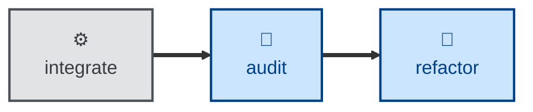

# Audit

The **audit** skill evaluates the as-built architecture of a codebase for
modularity, consistency, coupling, and the placement of its structural
boundaries.

The agent is instructed to conduct the evaluation on its own terms, with no
reference to the documented architecture, and no knowledge of trade-offs
already considered. That deliberate blindness is the point. It keeps the review
unbiased, so the agent is more likely to surface genuinely useful suggestions
about how the architecture could be improved.

The trade-off is a bit more noise in the output. The agent may retread design
trade-offs that have long been settled.

This is an evaluation skill. It changes no code. The output is a single
architectural audit report, written to a store the agent resolves from the
context its given, else from the local environment.

## Interactivity

This skill instructs the agent to run non-interactively. The agent is told not
to prompt the user for answers to anything it is not sure about. Instead, if
the agent cannot complete its task from the initial single-shot prompt, it is
instructed to stop and return an error message. This makes the skill useful in
away-from-keyboard workflows and automated delivery pipelines.

## How to invoke

> Audit this codebase.

> Do an architectural audit.

> Is the design still sound?

The agent audits the repository in the current working directory, at its
checked-out revision. Run from outside a repository, you may name the target
codebase as a path or a repository URL. Either way, you may pin the audit to a
particular commit.

## Recommended models

A premium frontier reasoning model, with "thinking" dialled up, will be best
suited to this task. This is open-ended analysis rather than mechanical
transformation.

## Suggested workflows

An architecture audit may be scheduled to run periodically, or be triggered by
a big changeset landing on the main trunk. Alternatively, it may be configured
as a preflight step in a release workflow. Wherever in a workflow architectural
audits are done, they will precede refactoring steps that act upon the findings
of the audit.

It is NOT RECOMMENDED to run an audit against every commit, especially in
continuous integration workflows. Architectural audits are computationally
expensive, and there is little value to be gained from running them
"continuously".

## Related skills

- [**refactor**](../refactor/). Pass the audit report to a coding agent as the
  context for a refactor.

- [**probe**](../probe/). The audit skill is scoped to the static structure
  of code and data. The [probe](../probe/) skill is a companion that instructs
  agents to look specifically at the security and privacy implications of the
  as-built design.

- [**validate**](../validate/). The audit skills asks whether the _design_
  of the system should evolve. The [validate](../validate/) skill asks
  whether the _specification_ of the system should evolve.
