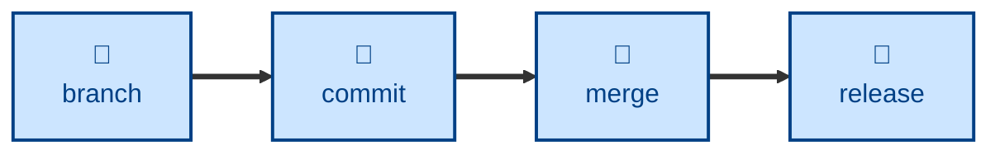

# Branch

The **branch** skill names and creates a Git branch for a piece of work,
following the trunk-based branching model defined in
[TS-9: Version Control][TS-9].

Work branches are either short-lived "temp" branches (named `[<pipeline>/]temp/*`)
or long-lived "epic" branches (named `[<pipeline>/]epic/*`). Both are cut from
the development trunk, named `[<pipeline>/]dev`.

Where a project prefixes its trunks with a delivery pipeline, ie. `latest/dev`
or `v2/dev` rather than `dev`, the new work branch takes the same prefix, eg.
`latest/temp/42-fix-auth`.

Committing, merging, and releasing are out-of-scope.

## Interactivity

This skill instructs the agent to run non-interactively. The agent is told not
to prompt the user for answers to anything it is not sure about. Instead, if
the agent cannot complete its task from the initial single-shot prompt, it is
instructed to stop and return an error message. This makes the skill useful in
away-from-keyboard workflows and automated delivery pipelines.

## How to invoke

> Create a branch for this work.

> Start a branch for issue 42.

> Start a branch in the v2 pipeline for this security patch.

Pass an issue number or other tracking identifier if you want it prefixed to
the branch name. Name the target delivery pipeline if the work does not belong
neither to the current checked-out development trunk nor the default "latest"
delivery pipeline.

## Recommended models

A small, fast model is sufficient for this task. The naming rules are quite
mechanical.

## Suggested workflows

Run this at the start of a new piece of work, once it is clear the change is too
large to land directly on the development trunk.

## Related skills

- [**commit**](../commit/).
  Composes commit messages for individual revisions.

- [**merge**](../merge/).
  Integrates work between two divergent branches.

- [**release**](../release/).
  Cuts release branches from the trunk.

## References

- [TS-9: Version Control][TS-9].
  The technical standard this skill encodes.

[TS-9]: https://kieranpotts.com/standards/009
