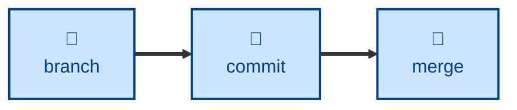

# Branch

The **branch** skill names and creates a Git branch for a piece of work,
following the trunk-based branching model defined in [TS-9: Version Control][TS-9].

Work branches are either short-lived "temp" branches — named `[<pipeline>/]temp/*` —
or long-lived "epic" branches — named `[<pipeline>/]epic/*`. The agent creates a
temp branch unless the user specifically asks for an epic.

The repository must be a bare clone in a `.bare` directory, with its worktrees
checked out in sibling directories, eg. `<project>/.bare` and
`<project>/default`. The agent stops if it is laid out any other way. It checks
the new branch out in a new worktree beside `.bare`, leaving the worktree you
invoked it from untouched.

## Interactivity

This skill instructs the agent to run non-interactively. The agent is told not
to prompt the user for answers to anything it is not sure about. Instead, if
the agent cannot complete its task from the initial single-shot prompt, it is
instructed to stop and report. This makes the skill useful in away-from-keyboard
workflows and automated delivery pipelines.

## How to invoke

> Create a branch for this work.

> Start a branch for issue 42.

> Start an epic branch for the billing rewrite.

Pass an issue number or other tracking identifier if you want it prefixed to
the branch name.

## Outcomes

The target repository is changed in the following ways.

- The local development trunk is fast-forwarded to match `origin`, and
  remote-tracking branches and tags are refreshed. Where the trunk is checked
  out in a worktree, that worktree must be clean, or the agent stops.

- There's a new branch, checked out in a new worktree beside `.bare`, named
  after the branch, eg. `<project>/latest-temp-42-fix-auth-timeout`. The new
  branch has no commits of its own, instead pointing to the same commit as the
  tip of the delivery pipeline's development trunk, eg. `latest/dev`. The
  branch exists locally only — nothing is pushed.

The agent's report opens with the new branch name on the first line, so an
orchestrator can read it, and the new worktree's path on the second. This is
followed by the commit hash that the branch starts from.

## Recommended models

A small, fast model is sufficient for this task. The naming rules are pretty
mechanical.

## Suggested workflows

Run this at the start of a new piece of work, where you want to keep the work
off the development trunk until it is stable enough to integrate.

## Related skills

- [**commit**](../commit/) \
  Commits the work on the new branch.

- [**merge**](../merge/) \
  Integrates the branch back into the development trunk.

## References

- [TS-9: Version Control][TS-9] \
  The technical standard this skill encodes.

[TS-9]: https://kieranpotts.com/standards/009
