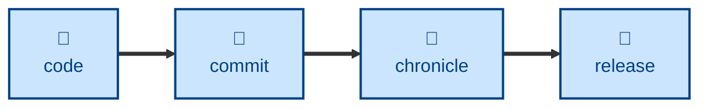

# Chronicle

The **chronicle** skill updates the "unreleased" section of a project's
changelog to accurately reflect the headline user-facing changes since the last
release, following the conventions defined in [TS-10: Releasing][TS-10].

The agent reads every commit since the last release tag on the current delivery
pipeline. It reads the commit messages only, not their diffs, and does not look
at untracked or uncommitted changes. It then reviews the "unreleased" section
of the changelog and updates it to accurately reflect the most noteworthy
user-facing changes. Minor tweaks and internal changes are left out, but
breaking changes, deprecations, removals, and security fixes always get a
changelog entry.

Where a project maintains several delivery pipelines in parallel, eg. "latest"
for v2 and "v1" for an older major version, the agent works out which pipeline
the checked-out branch belongs to. It takes the last release from that
pipeline's own tags, so it never mixes up one version series' releases with
another's.

Changelog entries are written for the software's end users. The changelog
format is loosely based on [Keep a Changelog](https://keepachangelog.com/).

Any edits made to the changelog are committed, on their own, with a `chore`
commit. No other file is staged or committed.

## Interactivity

This skill instructs the agent to run non-interactively. The agent is told not
to prompt the user for answers to anything it is not sure about. Instead, if
the agent cannot complete its task from the initial single-shot prompt, it is
instructed to stop and return an error message. This makes the skill useful in
away-from-keyboard workflows and automated delivery pipelines.

## How to invoke

> Update the changelog.

## Recommended models

A mid-range model is RECOMMENDED. Judging which changes are worth chronicling
takes judgment that a small model applies unreliably.

## Suggested workflows

Run this once the changes are committed, before cutting a new release.

## Related skills

- [**commit**](../commit/).
  Commits the changes that the changelog describes.

- [**release**](../release/).
  Promotes the "unreleased" section of the changelog to a released version.

## References

- [TS-10: Releasing][TS-10].
  The technical standard this skill encodes.

[TS-10]: https://kieranpotts.com/standards/010
