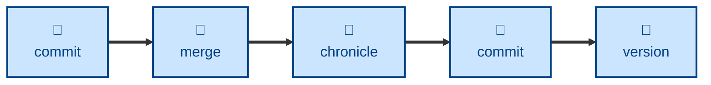

# Chronicle

The **chronicle** skill updates the "unreleased" section of a project's
changelog to accurately reflect the headline user-facing changes since the last
release point, following the conventions defined in [TS-10: Releasing][TS-10].

The changelog format is loosely based on [Keep a Changelog](https://keepachangelog.com/).
Changelog entries are written for the software's end users. The skill edits the
changelog only, and leaves the edits uncommitted, for a separate commit step to
capture.

The edits always land on the delivery pipeline's development trunk, eg.
`latest/dev`. The repository must be a bare clone in a `.bare` directory, with
its worktrees checked out in sibling directories, eg. `<project>/.bare` and
`<project>/default`. The agent stops if the repository is laid out any other
way. It works in the trunk's worktree, creating one if it does not already
exist, and stops if that worktree has uncommitted changes.

## Interactivity

This skill instructs the agent to run non-interactively. The agent is told not
to prompt the user for answers to anything it is not sure about. Instead, if
the agent cannot complete its task from the initial single-shot prompt, it is
instructed to stop and report. This makes the skill useful in away-from-keyboard
workflows and automated delivery pipelines.

## How to invoke

> Update the changelog.

> Bring the changelog up to date.

## Outcomes

The target repository is changed in the following ways.

- The "unreleased" section of the changelog is updated to cover every headline
  change since the last release. Released sections are left untouched.

- The edits are left uncommitted and unstaged in the development trunk's
  worktree, which is created if it did not exist. No commit is made.

The agent's report opens with `updated` or `no changes`. This is written on
the first line, so an orchestrator can read it, and the trunk's worktree path
on the second. This is followed by the entries added, revised, merged, or
removed.

## Recommended models

A mid-range model is RECOMMENDED. Judging which changes are worth chronicling
takes judgment that a small model applies unreliably.

## Suggested workflows

Run this once changes for the next version are committed, but before preparing
the next version and its release. Commit the changelog edits before moving on.

## Related skills

- [**commit**](../commit/) \
  Use this skill to commits the changes made to the changelog.

- [**version**](../version/) \
  Promotes the "unreleased" section of the changelog to a released version.

## References

- [TS-10: Releasing][TS-10] \
  The technical standard this skill encodes.

- [TS-9: Version Control][TS-9] \
  The commit conventions and delivery pipelines the skill reads.

[TS-9]: https://kieranpotts.com/standards/009
[TS-10]: https://kieranpotts.com/standards/010
