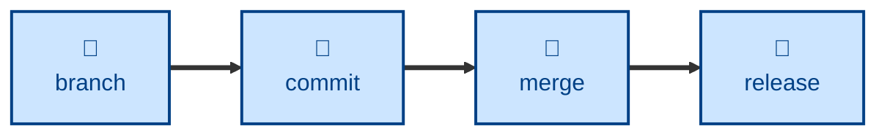

# Commit

The **commit** skill commits pending changes to Git as a single commit,
following the convention defined in [TS-9: Version Control][TS-9].

If the index holds changes, the agent commits those alone and leaves the rest
of the dirty working tree untouched. Otherwise it commits everything — modified,
deleted, and untracked files alike.

To split a large change into several atomic commits, stage each atomic increment
yourself and invoke the skill once per increment.

The agent writes the commit message from its own analysis of the changeset, not
from wording in your prompt. The message follows a fixed format:
`<type>: <description> [- <flag>]`. The `<type>` comes from a closed
vocabulary with precise semantics.

The agent is instructed not to modify any files, including changelogs. The agent
does not amend, rewrite, or push commits, and it never bypasses Git hooks.

The skill does not handle merges. If a merge or squash merge is in progress,
the agent stops without committing, even where every conflict is resolved.

## Interactivity

This skill instructs the agent to run non-interactively. The agent is told not
to prompt the user for answers to anything it is not sure about. Instead, if
the agent cannot complete its task from the initial single-shot prompt, it is
instructed to stop and return an error message. This makes the skill useful in
away-from-keyboard workflows and automated delivery pipelines.

Invoking the skill counts as permission to commit. The commit stays local
until you push it, so you can still review it with `git show` and undo it with
`git reset HEAD~1`.

## How to invoke

> Commit this.

> Commit the staged changes.

## Recommended models

A small, fast model is sufficient. The work is a constrained transformation
against a fixed vocabulary, not open-ended reasoning.

## Suggested workflows

## Related skills

- [**branch**](../branch/).
  Creates temporary and long-lived branches for feature development.

- [**chronicle**](../chronicle/).
  Summarizes the headline changes in the commits since the last release.

- [**merge**](../merge/).
  Integrates work between two divergent branches.

- [**release**](../release/).
  Cuts release branches from the trunk.

## References

- [TS-9: Version Control][TS-9].
  The technical standard this skill encodes.

- [Validate commit messages action](https://github.com/kieranpotts/actions/tree/dev/validate-commit-messages).
  The GitHub action that validates commit messages against these conventions.

- [Pre-commit hooks](https://github.com/kieranpotts/pre-commit-hooks).
  Validate commit messages against the same conventions, locally.

[TS-9]: https://kieranpotts.com/standards/009
