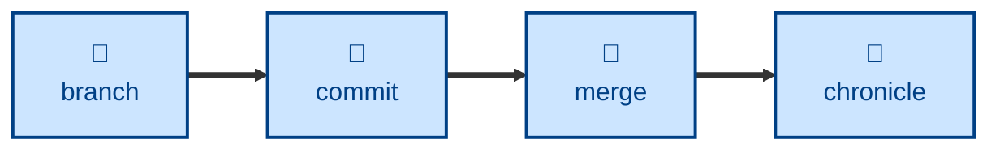

# Commit

The **`commit`** skill commits pending changes to Git as a single commit,
following the conventions defined in [TS-9: Version Control][TS-9].

The agent commits the staged changes, or everything (including untracked files)
in the working tree if nothing is yet staged. It writes the commit message from
the changeset, read alongside the session's conversation and the repository's
recent history, in the format `<type>: <description>[ - <flag>]`. The message
describes only what the commit contains.

The repository must be a bare clone in a `.bare` directory, with its worktrees
checked out in sibling directories, eg. `<project>/.bare` and
`<project>/default`. The agent stops if it is laid out any other way.

## Interactivity

This skill instructs the agent to run non-interactively. The agent is told not
to prompt the user for answers to anything it is not sure about. Instead, if
the agent cannot complete its task from the initial single-shot prompt, it is
instructed to stop and report. This makes the skill useful in away-from-keyboard
workflows and automated delivery pipelines.

Invoking the skill counts as permission to commit. The commit stays local
until you push it, so you can still review it with `git show` and undo it with
`git reset HEAD~1`.

## How to invoke

> Commit this.

> Commit the staged changes.

> Commit this — it's temporary debug logging.

## Outcomes

The target repository has one new commit on the checked-out branch. Nothing is
pushed.

The agent's report opens with the new commit's short hash on the first line, so
an orchestrator can read it. This is followed by the commit's subject and the
files it touched.

## Recommended models

A small, fast model is sufficient. The work is a constrained transformation
against a fixed vocabulary, not open-ended reasoning.

## Suggested workflows

## Related skills

- [**`branch`**](../branch/) \
  Creates the temp or epic branch that the commits land on.

- [**`chronicle`**](../chronicle/) \
  Summarizes the headline changes in the commits since the last release.

- [**`merge`**](../merge/) \
  Integrates a branch's commits into the development trunk.

- [**`version`**](../version/) \
  Reads the commit types and flags to decide the next version number.

## References

- [TS-9: Version Control][TS-9] \
  The technical standard this skill encodes.

- [Validate commit messages action](https://github.com/kieranpotts/actions/tree/dev/validate-commit-messages) \
  The GitHub action that validates commit messages against these conventions.

- [Pre-commit hooks](https://github.com/kieranpotts/pre-commit-hooks) \
  Validate commit messages against the same conventions, locally.

[TS-9]: https://kieranpotts.com/standards/009
