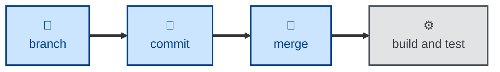

# Merge

The **merge** skill integrates the checked-out branch into another branch in
the same delivery pipeline, following the rules defined in
[TS-9: Version Control][TS-9].

The integration strategy is determined from the branch types. Temp branches are
rebased and fast-forwarded on trunks. Epics are squashed onto trunks. And trunks
are fast-forwarded to other trunks.

The agent aborts on any conflict, and leaves testing, pushing, and cleanup to
you.

The repository must be a bare clone in a `.bare` directory, with its worktrees
checked out in sibling directories, eg. `<project>/.bare` and
`<project>/default`. The agent stops if it is laid out any other way. It works
on the target branch in that branch's own worktree, creating one beside
`.bare` if there is none, and stops if either the current worktree or the
target's has uncommitted changes.

## Interactivity

This skill instructs the agent to run non-interactively. The agent is told not
to prompt the user for answers to anything it is not sure about. Instead, if
the agent cannot complete its task from the initial single-shot prompt, it is
instructed to stop and report. This makes the skill useful in away-from-keyboard
workflows and automated delivery pipelines.

## How to invoke

> Merge this branch.

> Integrate this back into the trunk.

> Promote dev to test.

> Merge dev into this epic.

## Outcomes

The target repository is changed in the following ways.

- The target branch carries the source branch's work, in its own worktree.
  The current worktree still has the source branch checked out.

- Shared local branches are fast-forwarded to match `origin`, and
  remote-tracking branches and tags are refreshed, from
  `git fetch origin --tags`.

No branch is deleted, and nothing is pushed.

The agent's report opens with the target branch and its new short hash on the
first line, eg. `latest/dev 3f9c2ab`, so an orchestrator can read it, and the
target worktree's path on the second.

## Recommended models

A mid-tier model is sufficient. The strategy follows mechanically from the
branch types, and conflicts are handed back to the user rather than resolved by
the agent. Writing the squash commit for an epic takes some judgment.

## Suggested workflows

Run this when a piece of work is finished and verified on its own branch, and
again to promote a trunk through its delivery pipeline (`dev` → `test` → `ready`
→ `release`).

## Related skills

- [**branch**](../branch/) \
  Creates the temp and epic branches this skill integrates.

- [**commit**](../commit/) \
  Commits ordinary, single-parent changes. Does not handle merges.

- [**release**](../release/) \
  Tags a release and fast-forwards `ready` and `release` to it.

## References

- [TS-9: Version Control][TS-9] \
  The technical standard this skill encodes.

[TS-9]: https://kieranpotts.com/standards/009
