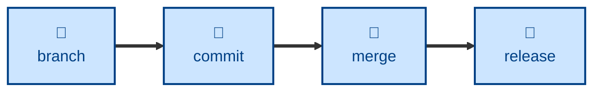

# Merge

The **merge** skill integrates work between two divergent Git branches,
following the reintegration rules of the trunk-based model described in
[TS-9: Version Control][TS-9].

The agent is told to identify the source and target branches, pick the merge
strategy their branch types call for, align the source with the target, verify
the merged result locally, and then push and clean up the disposable branch.

The agent does not resolve merge conflicts. If Git cannot complete a rebase or
merge by itself, the agent aborts it, leaving both branches as they were, and
reports the conflicted files for you to resolve.

## Interactivity

This skill instructs the agent to run non-interactively. The agent is told not
to prompt the user for answers to anything it is not sure about. Instead, if
the agent cannot complete its task from the initial single-shot prompt, it is
instructed to stop and return an error message. This makes the skill useful in
away-from-keyboard workflows and automated delivery pipelines.

## How to invoke

> Merge this branch into `latest/dev`.

> Integrate `latest/temp/...` back into the trunk.

> Promote `latest/dev` to `latest/test`.

Name both branches where the repository has more than one trunk. Both must sit
in the same delivery pipeline (eg. both `latest/` or both `v2/`). The agent
refuses to merge across delivery pipelines.

## Recommended models

A mid-tier model is sufficient, since the strategy follows mechanically from
the branch types, and conflicts are handed back to the user rather than
resolved by the agent.

## Suggested workflows

Run this skill when a piece of work is finished and verified on its own
branch.

## Related skills

- [**branch**](../branch/).
  Creates temporary and long-lived branches for feature development.

- [**commit**](../commit/).
  Commits ordinary, single-parent changes. Does not handle merges.

- [**release**](../release/).
  Cuts release branches from the trunk.

## References

- [TS-9: Version Control][TS-9].
  The technical standard this skill encodes.

[TS-9]: https://kieranpotts.com/standards/009
