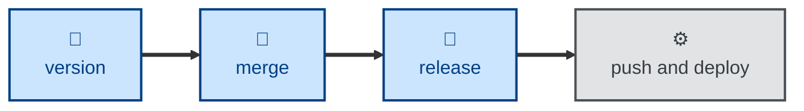

# Release

The **release** skill cuts a software release, following the conventions
defined in [TS-9: Version Control][TS-9] and [TS-11: Versioning][TS-11].

The agent tags the `version: <version>` commit — which is expected to already
exist — and then fast-forwards the `[<pipeline>/]ready` trunk to the tag, then
`[<pipeline>/]release` to `[<pipeline>/]ready`. The agent makes no new commits,
and pushes nothing.

The repository must be a bare clone in a `.bare` directory, with its worktrees
checked out in sibling directories, eg. `<project>/.bare` and
`<project>/default`. The agent stops if it is laid out any other way. It moves
`ready` and `release` in their own worktrees, creating them beside `.bare`
where there are none, and stops if either has uncommitted changes.

## Interactivity

This skill instructs the agent to run non-interactively. The agent is told not
to prompt the user for answers to anything it is not sure about. Instead, if
the agent cannot complete its task from the initial single-shot prompt, it is
instructed to stop and report. This makes the skill useful in away-from-keyboard
workflows and automated delivery pipelines.

## How to invoke

> Release 1.2.0.

> Tag version 1.2.0.

> Cut the 1.3.0-rc.0 pre-release.

The version number to release MUST be explicitly named in the prompt. The skill
can be run from any branch in the delivery pipeline from which the release is to
be cut.

## Outcomes

The target repository is changed in the following ways.

- It has a new annotated tag, `v<version>`, on the existing
  `version: <version>` commit.

- The `[<pipeline>/]ready` and `[<pipeline>/]release` trunks are
  fast-forwarded to the tag, each in its own worktree, except for a
  pre-release, which leaves them where they are.

No commits are made, and nothing is pushed.

The agent's report opens with the tag on the first line, eg. `v1.2.0`, so an
orchestrator can read it. This is followed by the tagged commit, the worktrees
moved or created, and the refs still to push.

## Recommended models

A small, fast model is sufficient. The work is a mechanical application of a
documented tagging and promotion convention, with no open-ended analysis.

## Suggested workflows

Run this once the version commit has passed quality assurance on the testing
trunk, and before deployment.

## Related skills

- [**merge**](../merge/) \
  Promotes the version commit from the development trunk to the testing trunk.

- [**version**](../version/) \
  Derives the version number and makes the version commit that this skill
  tags.

## References

- [TS-9: Version Control][TS-9] \
  The trunk and release conventions this skill encodes.

- [TS-10: Releasing][TS-10] \
  How release cadence maps onto the release trunk.

- [TS-11: Versioning][TS-11] \
  The versioning scheme and tagging convention the skill applies.

[TS-9]: https://kieranpotts.com/standards/009
[TS-10]: https://kieranpotts.com/standards/010
[TS-11]: https://kieranpotts.com/standards/011
