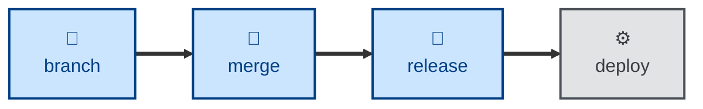

# Release

The **release** skill cuts a software release and applies its version tag,
following the conventions defined in [TS-9: Version Control][TS-9].

The agent is instructed to work out the appropriate release strategy from the
session context and local environment. The project is expected to use either a
single permanent `[<pipeline>/]release` trunk, or multiple temporary
`[<pipeline>/]release/<version>` branches. The agent promotes the latest
changes on the release-ready trunk — named `[<pipeline>/]ready` — to the
relevant release trunk or release branch. It then promotes the changelog's
"unreleased" items, applies an annotated version tag, and pushed the changes
to the upstream repository — this is expected to trigger a deployment pipeline.

## Interactivity

This skill instructs the agent to run non-interactively. The agent is told not
to prompt the user for answers to anything it is not sure about. Instead, if
the agent cannot complete its task from the initial single-shot prompt, it is
instructed to stop and return an error message. This makes the skill useful in
away-from-keyboard workflows and automated delivery pipelines.

## How to invoke

> Cut a release.

> Tag version 1.2.0.

> Prepare a release branch.

> Cut a 2.3.1 patch release from the v2 pipeline.

## Recommended models

A small, fast model is sufficient. The work is a mechanical application of a
documented branching and tagging convention, with no open-ended analysis.

## Suggested workflows

Run this once the release-ready trunk holds the revisions you intend to ship,
after integration and before deployment.

## Related skills

- [**branch**](../branch/).
  Creates temporary and long-lived branches for feature development.

- [**chronicle**](../chronicle/).
  Keeps the "unreleased" section of the changelog up-to-date, ready to promote.

- [**commit**](../commit/).
  Composes commit messages for individual revisions.

- [**merge**](../merge/).
  Integrates work between two divergent branches.

## References

- [TS-9: Version Control][TS-9].
  The release branching conventions this skill encodes.

- [TS-10: Releasing][TS-10].
  How a released version is headed in the changelog, and how release cadence
  maps onto the release model.

- [TS-11: Versioning][TS-11].
  The versioning scheme and tagging convention the skill applies.

[TS-9]: https://kieranpotts.com/standards/009
[TS-10]: https://kieranpotts.com/standards/010
[TS-11]: https://kieranpotts.com/standards/011
