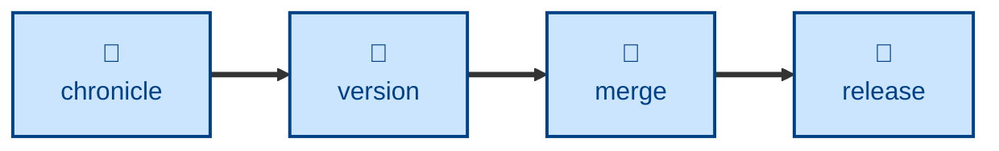

# Version

The **version** skill works out the next version number for a delivery
pipeline, following the Semantic Versioning rules defined in
[TS-11: Versioning][TS-11].

The agent derives the version bump from the commit types and flags since the
last release tag on the current delivery pipeline. It then promotes the
changelog's "unreleased" section to that version, and commits it as
`version: <version>`. Nothing is pushed.

The repository must be a bare clone in a `.bare` directory, with its worktrees
checked out in sibling directories, eg. `<project>/.bare` and
`<project>/default`. The agent stops if it is laid out any other way, or if the
current worktree has uncommitted changes.

## Interactivity

This skill instructs the agent to run non-interactively. The agent is told not
to prompt the user for answers to anything it is not sure about. Instead, if
the agent cannot complete its task from the initial single-shot prompt, it is
instructed to stop and report. This makes the skill useful in away-from-keyboard
workflows and automated delivery pipelines.

## How to invoke

> Bump the version.

> Prepare the next release candidate.

## Outcomes

The target repository has one new commit, `version: <version>`, that promotes
the changelog's "unreleased" section to the new version and updates the
version manifests. No tag is created, and nothing is pushed.

The agent's report opens with the next version on the first line, bare, eg.
`1.3.0`, so an orchestrator can read it. This is followed by the release
baseline tag, the bump level, and a list of the commits that decided the new
version number.

## Recommended models

A small, fast model is sufficient. The bump rules are mechanical, and work from
commit types and flags that the commit authors have already chosen.

## Suggested workflows

Run this once the changelog's "unreleased" section is up to date, and before
promoting the version commit through the pipeline to cut the release.

## Related skills

- [**chronicle**](../chronicle/) \
  Writes the changelog entries that this skill promotes.

- [**commit**](../commit/) \
  Sets the commit types and flags that this skill reads to decide the bump.

- [**merge**](../merge/) \
  Promotes the version commit through the pipeline's trunks.

- [**release**](../release/) \
  Tags the version commit, and fast-forwards `ready` and `release` to it.

## References

- [TS-11: Versioning][TS-11] \
  The versioning scheme and bump rules this skill encodes.

- [TS-9: Version Control][TS-9] \
  The commit conventions, delivery pipelines, and version commits the skill
  acts on.

- [TS-10: Releasing][TS-10] \
  How a released version is headed in the changelog.

[TS-9]: https://kieranpotts.com/standards/009
[TS-10]: https://kieranpotts.com/standards/010
[TS-11]: https://kieranpotts.com/standards/011
