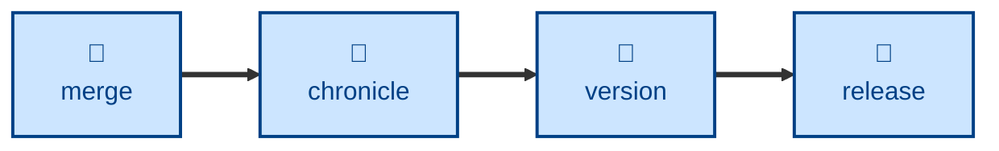

# Version

The **version** skill works out the next version number for a delivery
pipeline, following the Semantic Versioning conventions defined in
[TS-11: Versioning][TS-11].

The agent finds the pipeline's last release tag, then reads the commit messages
made since, up to the tip of the release-ready trunk. It reads the commit
messages only, not their diffs. Each commit's type and flags decide the bump
it calls for, and the highest bump wins:

- A commit flagged `BREAKING` calls for a major bump.
- A `behavior`, `fix`, or `quality` commit calls for a minor bump.
- A `maintenance`, `refactor`, `style`, or `chore` commit calls for a patch
  bump.
- `step` and `version` commits, and reverts, call for no bump.

Where a project maintains several delivery pipelines in parallel, eg. "latest"
for v2 and "v1" for an older major version, the agent takes the last release
from the pipeline's own tags. It stops if the bump would take the version
outside the pipeline's version series, eg. a breaking change on the v1
pipeline.

This skill only reports the version. It does not tag, commit, or edit any
file. The report opens with the bare version number on its own line, so a
script or orchestrator can read it.

## Interactivity

This skill instructs the agent to run non-interactively. The agent is told not
to prompt the user for answers to anything it is not sure about. Instead, if
the agent cannot complete its task from the initial single-shot prompt, it is
instructed to stop and return an error message. This makes the skill useful in
away-from-keyboard workflows and automated delivery pipelines.

## How to invoke

> What's the next version?

> Work out the next version number.

> What would the v1 pipeline release next?

> What would the next release candidate be?

Name a delivery pipeline if you want the next version of a pipeline other than
the one the checked-out branch belongs to. Name a branch or commit if the
release will be cut from somewhere other than the pipeline's release-ready
trunk.

## Recommended models

A small, fast model is sufficient. The bump rules are mechanical, and work from
commit types and flags that the commit authors have already chosen.

## Suggested workflows

Run this once the release-ready trunk holds the revisions you intend to ship,
just before cutting the release.

## Related skills

- [**chronicle**](../chronicle/).
  Writes the changelog entries for the release being versioned.

- [**commit**](../commit/).
  Sets the commit types and flags that this skill reads to decide the bump.

- [**release**](../release/).
  Cuts the release and applies the version tag.

## References

- [TS-11: Versioning][TS-11].
  The versioning scheme and bump rules this skill encodes.

- [TS-9: Version Control][TS-9].
  The commit conventions and delivery pipelines the bump rules act on.

[TS-9]: https://kieranpotts.com/standards/009
[TS-11]: https://kieranpotts.com/standards/011
